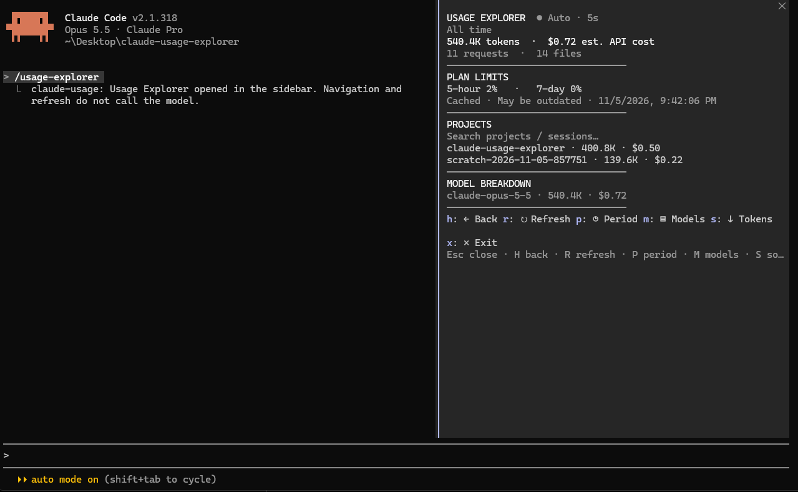
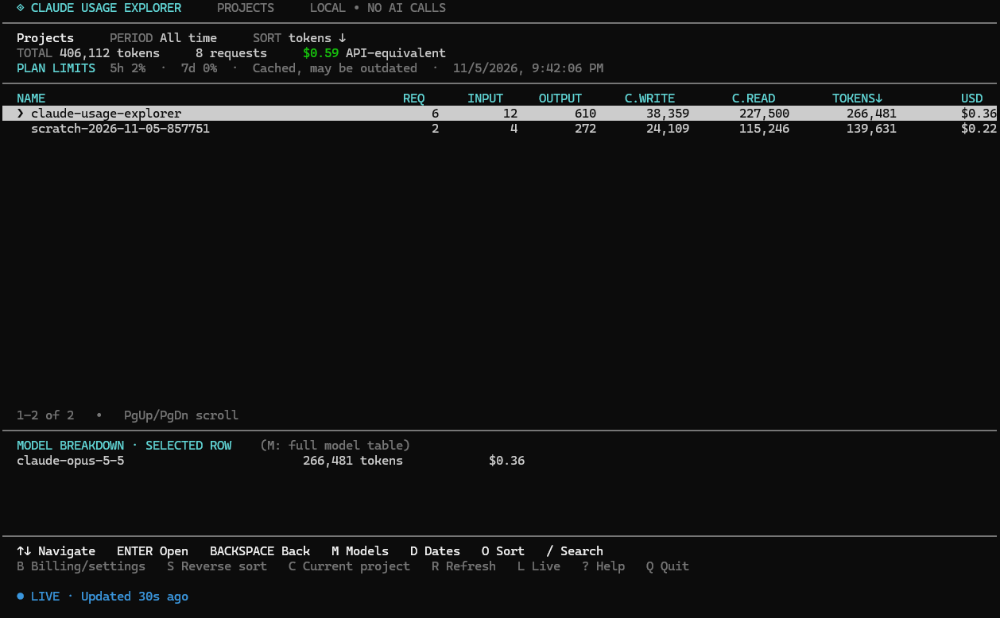

# Claude Usage Explorer

**Explore Claude Code token usage, estimated API-equivalent costs, projects, sessions, and agents — locally.** Use a native Claude Code sidebar or a standalone terminal dashboard. No uploads, telemetry, or external npm dependencies.

[](https://www.npmjs.com/package/claude-usage-explorer)
[](LICENSE)

## What's new in v1.1.0

- **Session actions:** open or copy session identifiers from supported views.
- **Account usage diagnostics:** optional official usage-limit and extra-spend information when accessible; not the same as estimated API-equivalent cost.
- **Cleaner agent navigation:** the main agent appears as **Agent (main)**; subagents use a recorded name when available, or **Subagent** when metadata is missing. Opaque agent IDs are shown only after opening an agent.
- **Native sidebar and standalone terminal explorer:** navigate projects, sessions, agents, and models with token and API-equivalent cost breakdowns.
- **Live refresh and flexible views:** filter and sort usage, switch reporting periods, and see per-model summaries.
- **Privacy-first:** transcript processing stays on your computer. Account plan-limit information, when available, is separate from local estimated API-equivalent cost.

**Important:** Subagent names depend on metadata in the local Claude transcript; names are not inferred when absent. Estimated API costs are not the amount billed for a Claude subscription.

## Preview

### Native Claude Code sidebar



Use `/usage-explorer` to inspect local usage without leaving your Claude Code session.

### Standalone terminal dashboard



Run `claude-usage tui` to explore projects, sessions, token usage, model breakdowns, and estimated costs.

## Quick start

**Standalone CLI (Node.js 20+):**

```sh
npm install -g claude-usage-explorer
claude-usage tui
```

**Claude Code community plugin marketplace:**

```sh
claude plugin marketplace add IliasPol/claude-usage
claude plugin install claude-usage@claude-usage-explorer-marketplace
```

Then run `/usage-explorer` in a compatible Claude Code session.

## Requirements

- Node.js 20+ (Node 22 recommended)
- Claude Code with native Mods support for the sidebar
- Local Claude Code JSONL transcript history

## Standalone CLI: other ways to run

Run without a global installation:

```sh
npx --yes --package claude-usage-explorer claude-usage tui
```

**Note:** On Windows PowerShell, use `npm.cmd` and `claude-usage.cmd` if execution policy blocks the `.ps1` shims.

To run directly from a local checkout, use:

```sh
node ./bin/claude-usage.mjs tui
```

Run the TUI in an **interactive terminal**, not inside a noninteractive Claude tool shell. The optional macOS/Linux installer `./scripts/install-command.sh` is still available for source checkouts but is not needed for npm installations.

## Claude Code plugin installation

Alternatively, from inside Claude Code use `/plugin marketplace add IliasPol/claude-usage`, followed by `/plugin install claude-usage@claude-usage-explorer-marketplace`.

This repository hosts a **community marketplace**, not an Anthropic-curated listing. After installation, use `/usage-explorer` in compatible Claude Code environments. Native mod/sidebar support may depend on the installed Claude Code version; if it is unavailable, the standalone `claude-usage tui` remains an option.

## Native sidebar: local development

Start Claude Code with the local plugin directory:

```sh
claude --plugin-dir /absolute/path/to/claude-usage-explorer
```

Then use `/usage-explorer`. In Claude Code CLI, `/tui fullscreen` may be required for the sidebar to appear. The native command is **`/usage-explorer`**, not `/claude-usage:open`.

The optional `/claude-usage:tui` skill attempts to open a **separate** terminal. This requires one model invocation and depends on your terminal environment. If no terminal appears, launch `node ./bin/claude-usage.mjs tui` directly in PowerShell or Terminal.

## Features

- Drill down into projects, sessions, agents and models
- Periods, sorting, filtering and auto-refresh
- Token totals and estimated API-equivalent cost by model
- Optional cached 5-hour and 7-day Claude Desktop plan-limit percentages (not live usage)
- Read-only, local processing; no uploads or external analytics

**Important:** Estimated API-equivalent cost is not what your Claude subscription was charged. Cached plan percentages can be stale. Claude Desktop Chat history is not included in Claude Code's local transcript analytics.

## Windows

In PowerShell, from the extracted project directory (or use the npm installation above):

```powershell
node .\bin\claude-usage.mjs tui
claude --plugin-dir "$PWD"
```

## Development

```sh
npm test
npm run check
```

The GitHub Actions workflow tests on Windows, macOS and Ubuntu.

## Contributing, security, and license

Contributions are welcome: see [CONTRIBUTING.md](CONTRIBUTING.md). Please report vulnerabilities following [SECURITY.md](SECURITY.md). This project is licensed under the [MIT License](LICENSE).

## Support

If Claude Usage Explorer is useful, consider [starring the repository](https://github.com/IliasPol/claude-usage). The tool is free and open source.
